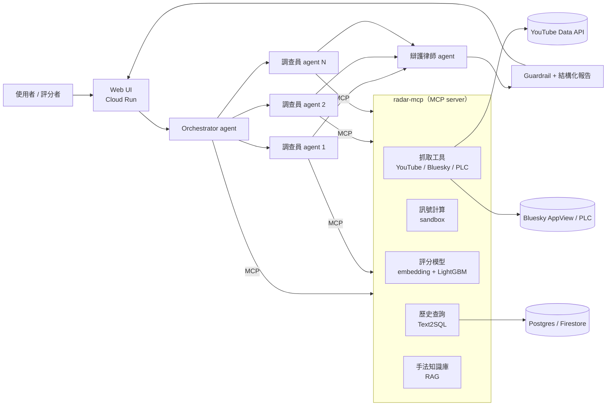
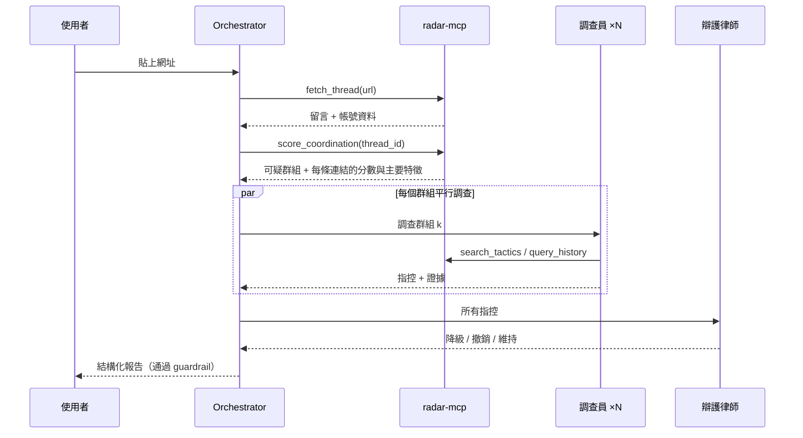
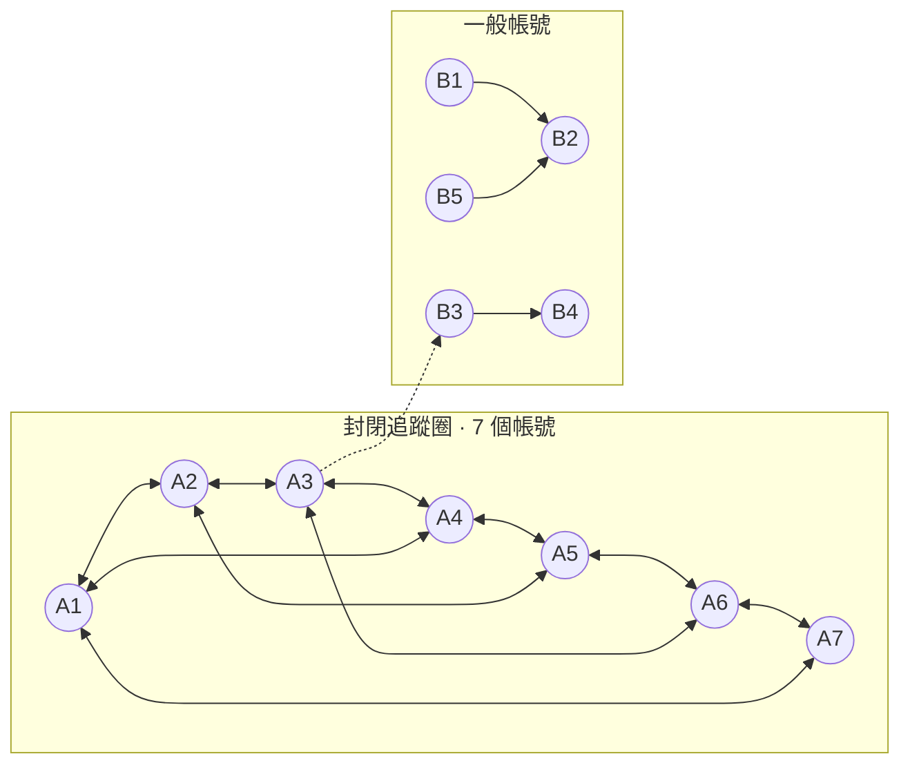

# 留言雷達 Comment Radar

> 找出 YouTube 和 Bluesky 留言區裡的協同帳號群組。
>
> 查證日期：2026-11-23。標「需實測」的項目要等可行性測試跑完才算確定。

**Pitch：** “We grew up in Taiwan, one of the most targeted countries for online disinformation. Now we built a radar for any comment section.”

台灣背景只當創辦人故事。demo 全部用英文的 YouTube 和 Bluesky 內容，評分者才能自己驗證。

| 日期 | 事項 |
|---|---|
| 12/1 | Moonshot 提案 |
| 12/9 23:59 | 繳交 repo |
| 12/10 | 期末報告（4 分鐘 + 1 分鐘問答） |
| 評分限制 | 每個任務最多等 5 分鐘 |

> ⚠️ **DESIGN.md 必須自己手寫，不能用 AI**，老師會用 Pangram 檢查。這份文件只是參考，請不要把句子貼進 DESIGN.md。

---

## 目錄

1. [要做什麼](#1-要做什麼)
2. [系統架構：MCP + 背後的評分模型](#2-系統架構mcp--背後的評分模型)
3. [資料可行性研究](#3-資料可行性研究)
4. [可行性測試清單](#4-可行性測試清單)
5. [課程概念對照](#5-課程概念對照)
6. [效果示意](#6-效果示意)
7. [給評分者的三個任務](#7-給評分者的三個任務readme-草稿)
8. [主要風險](#8-主要風險)
9. [時程](#9-時程)
10. [查證來源](#10-查證來源)

---

## 1. 要做什麼

使用者貼上一支 YouTube 影片或一則 Bluesky 貼文的網址。agent 會抓下留言和留言者的資料，找出行為像在一起行動的帳號群組，並為每個群組附上證據和信心分數。

### 痛點

熱門影片底下的留言常被當成「民意」。但裡面可能有一群協同帳號在帶風向，也可能是加密貨幣詐騙機器人互相回覆、假裝推薦。記者、事實查核者和創作者都很難一眼看出哪些留言是有組織的。

### User story（草稿）

> As a journalist or fact-checker, I want to know whether the comments under a viral video are organic or coordinated, so that I don’t report manufactured outrage as public opinion.

### 核心原則

**我們不判定「誰是網軍」，只找出「哪一群帳號有協同行為」，並附上機率和證據。**

2021 年台灣的「浪人 47」事件是前車之鑑：一份網軍名單裡，有人只是住在海外或用了 VPN。誤判真人比漏抓更傷，所以 eval 優先看偽陽性率。

### 功能

| 功能 | 說明 |
|---|---|
| 貼網址就分析 | 支援 YouTube 影片和 Bluesky 貼文。抓留言、回覆和留言者的帳號資料；Bluesky 另外抓追蹤關係 |
| 證據報告 | 每個群組列出證據：留言時間集中、文字高度相似、帳號同一週建立、互相追蹤成封閉小圈圈、在其他影片也一起出現 |
| 辯護律師機制 | 一個 agent 專門替被懷疑的帳號找無辜的解釋，例如「這是首播，留言本來就會集中」。證據撐不住的群組會被降級或撤銷 |
| 跨影片追蹤 | 分析結果會累積。可以問「這群帳號過去 30 天還出現在哪些影片？」，agent 會產生 SQL 查詢並畫圖 |

---

## 2. 系統架構：MCP + 背後的評分模型

### 2.1 設計想法

系統分三層，每一層只做自己擅長的事：

| 層 | 負責 | 為什麼這樣分 |
|---|---|---|
| **MCP server**（`radar-mcp`） | 抓資料、算訊號、跑評分模型、查資料庫 | 工具和 agent 分開。任何 MCP client（我們的 agent、Claude Desktop、Cursor）都能直接用 |
| **評分模型**（在 MCP server 裡） | 判斷「這兩個帳號是不是一起行動」並給出分數 | LLM 不適合對幾百個帳號做數值判斷，又貴又不穩定。小模型便宜、快、結果可重現，也可以做 eval |
| **LLM agents** | 調查、辯護、寫報告 | LLM 負責解讀證據和寫成人看得懂的報告，不負責算數字 |

### 2.2 架構圖



### 2.3 一次分析的流程



### 2.4 MCP server 提供的工具

| 工具 | 輸入 | 輸出 | 說明 |
|---|---|---|---|
| `fetch_thread` | YouTube 或 Bluesky 網址、上限則數 | `thread_id`、留言數 | 抓留言和回覆並存入資料庫，有快取 |
| `get_accounts` | `thread_id` | 每個留言者的建立日期、活動量、標籤 | YouTube 用 `channels.list`；Bluesky 用 `getProfiles`，缺資料時查 PLC |
| `get_follow_graph` | `thread_id` | 帳號之間的追蹤邊 | 只有 Bluesky 有 |
| `compute_signals` | `thread_id` | 時間爆發區段、文字相似群、建立時間群聚 | 在 sandbox 裡跑 |
| `score_coordination` | `thread_id`、門檻 | 群組清單；每條連結附分數和前 3 名特徵 | **背後的評分模型**，見 2.5 |
| `query_history` | 自然語言問題 | SQL、結果、圖表規格 | Text2SQL，資料庫唯讀 |
| `search_tactics` | 群組特徵描述 | 最相近的已知手法和出處 | 語意 RAG，內容來自公開報告和論文 |

MCP 的另外兩種功能也可以用上：

- **Resources**：把手法知識庫的文件掛成 resource，client 可以直接瀏覽。
- **Prompts**：把「調查一個群組」做成 prompt 範本，在 Claude Desktop 裡也能一鍵使用。

### 2.5 背後的評分模型

**模型判斷的是「兩個帳號在這串留言裡是不是一起行動」，而不是判斷單一帳號是不是機器人。** 這樣做符合「看群組、不點名個人」的原則，也比較好標註。

運作分三步：

1. **配對**：把同一串留言裡有交集的帳號兩兩配對，例如時間相近、互相回覆或文字相似的帳號。
2. **打分**：模型為每一對帳號給出 0 到 1 的協同分數。
3. **分群**：只保留分數超過門檻的連結，用連通元件或 Louvain 演算法切出群組。

**每一對帳號的特徵：**

| 特徵 | 來源 |
|---|---|
| 兩則留言的時間差 | 留言時間 |
| 文字 embedding 的 cosine 相似度 | 留言全文 |
| 兩個帳號建立日期的差距 | `channels.list` / `getProfiles` / PLC |
| 兩個帳號是否都很新（例如建立不到 30 天） | 同上 |
| 是否互相回覆、是否在同一個回覆串 | 回覆結構 |
| 是否互相追蹤（只有 Bluesky） | `getFollows` |
| 過去一起出現過幾次 | 我們的資料庫 |
| 雙方的活動量（影片數、貼文數、訂閱數） | 帳號資料 |

**模型選擇：**

| 元件 | 選擇 | 理由 |
|---|---|---|
| 文字 embedding | `all-MiniLM-L6-v2`（sentence-transformers，在本機跑） | 約 90 MB，Cloud Run 的 CPU 就能跑，不用花 API 費用 |
| 分類器 | 先做 logistic regression 當 baseline，再試 LightGBM | 資料量小，模型越簡單越不容易過擬合；兩者都能說出是哪些特徵讓分數變高 |
| 解釋 | 每條連結回傳貢獻最大的 3 個特徵 | 報告上的證據標籤直接從這裡來，LLM 不用自己編 |

**訓練和評估：**

- **正例**：Collusion Scam 資料集裡同一個詐騙串的帳號配對，加上我們自建標註集裡標成同一群的配對。
- **負例**：普通影片的帳號配對。一定要包含首播、直播和名人轉貼這類「留言自然集中」的影片。
- **切資料**：用 group k-fold，以影片為單位切，同一支影片不會同時出現在訓練集和測試集，避免資料外洩。
- **選門檻**：先限制普通影片的偽陽性率不超過 5%，再在這個條件下把抓到率調到最高。每改一次特徵或門檻就重跑 eval，這對應課程的 hill-climbing。
- **部署**：模型存成一個 `joblib` 小檔案，MCP server 啟動時載入。

**模型和 LLM 的分工：**

- 模型只給分數和特徵，不寫結論。
- 調查員 agent 把分數翻成人看得懂的證據。
- 辯護律師可以反駁模型的判斷，例如「這兩個帳號時間很近，是因為影片剛首播」。

### 2.6 部署方式

| 方案 | 做法 | 優點 | 缺點 |
|---|---|---|---|
| **A. 單一服務** | agent 和 MCP server 放同一個 Cloud Run 容器，用 stdio 連線 | 最簡單，一個服務、一條 GitHub 持續部署 | 外部 MCP client 用不到 |
| **B. 兩個服務** | `radar-mcp` 獨立部署成 Cloud Run 服務（Streamable HTTP），agent 服務透過網址連過去 | demo 時可以把我們的雷達直接接進 Claude Desktop，很有說服力 | 兩條部署流程，要處理驗證（API key header） |

**建議先做 A，核心功能完成後再拆成 B。** 兩者的工具程式碼完全一樣，只差連線方式。

技術選擇：

- **MCP server**：Python 官方 `mcp` 套件（FastMCP），同時支援 stdio 和 Streamable HTTP。
- **Agent 端**：沿用課程的框架。OpenAI Agents SDK 有 `MCPServerStdio` 和 `MCPServerStreamableHttp` 兩個類別可以直接掛上 MCP server。
- **資料庫**：Cloud Run 的檔案系統是暫時的，帳號紀錄和分析結果要放 Cloud SQL（Postgres）或 Firestore。Text2SQL 用 Postgres 會比較順。

---

## 3. 資料可行性研究

狀態說明：

| 標記 | 意思 |
|---|---|
| ✅ 已查證 | 官方文件確認可用 |
| 🧪 需實測 | 文件說可以，但有人回報問題 |
| 📨 需申請 | 要寄信或填表，等對方回覆 |
| ❔ 未證實 | 只有第三方的說法 |

### 3.1 每種證據需要哪些資料

先決定要抓哪些訊號，再看哪個平台給得出來。

| 協同訊號 | 為什麼可疑 | YouTube | Bluesky | 對應欄位或端點 |
|---|---|:---:|:---:|---|
| 時間爆發 | 一堆留言擠在幾分鐘內出現 | ✅ | ✅ | `publishedAt` / 貼文 `createdAt` |
| 文字高度相似 | 同一個模板換幾個字 | ✅ | ✅ | 留言全文，用 embedding 分群 |
| 帳號建立時間群聚 | 一批帳號在同一週註冊 | ✅ | ✅ | YouTube `channels.list` 的 `publishedAt`；Bluesky 個人資料的 `createdAt` 或 PLC 稽核紀錄 |
| 回覆鏈互捧 | 一則推薦文底下一串「我也是」 | ✅ | ✅ | YouTube 回覆串；Bluesky 貼文串 |
| 封閉追蹤圈 | 一群帳號互相追蹤，幾乎不追蹤圈外 | ❌ | ✅ | `app.bsky.graph.getFollows` |
| 跨貼文共現 | 同一批帳號總是一起出現 | 要累積 | 要累積 | 我們自己的資料庫 |
| 帳號活動稀薄 | 沒有上傳、沒有其他互動 | ✅ | ✅ | 頻道影片數、訂閱數；Bluesky 貼文數、追蹤數 |
| 平台已標記 | 平台自己貼了 spam 標籤 | ❌ | 🧪 | 個人資料的 `labels` 欄位、`com.atproto.label.queryLabels` |
| IP、裝置 | 同一台機器操作多個帳號 | ❌ | ❌ | 只有平台內部有，我們不靠這個 |

### 3.2 主要資料：demo 和產品實際使用的

#### YouTube Data API v3　✅ 已查證

- **拿到什麼**：任何公開影片的留言、回覆、留言時間和按讚數；留言者頻道的建立日期、訂閱數和影片數。
- **費用**：免費。每個 Google Cloud 專案每天 10,000 單位。
- **額度**：`commentThreads.list`、`comments.list`、`channels.list` 每次都只算 1 單位；寫入類操作才是 50 單位。
- **怎麼拿**：Google Cloud Console 建專案 → 啟用 YouTube Data API v3 → 建 API key。不需要 OAuth，五分鐘內可以完成。
- **限制**：開發者政策規定 API 資料要在 30 天內更新或刪除，所以留言全文不能永久保存（見[風險](#8-主要風險)）。
- **用途**：主力 demo。加密貨幣詐騙回覆鏈很常見，評分者一看就懂。
- 連結：[額度表](https://developers.google.com/youtube/v3/determine_quota_cost)、[開發者政策](https://developers.google.com/youtube/terms/developer-policies)

#### Bluesky AppView 公開 API　🧪 需實測

- **拿到什麼**：
  - 貼文串：`getPostThread`
  - 批次個人資料：`getProfiles`，一次最多 25 個帳號
  - 追蹤清單：`getFollows`
  - 粉絲清單：`getFollowers`
- **費用**：免費、免登入。主機是 `public.api.bsky.app`。
- **速率限制**：官方只寫 AppView「很寬鬆，被限流再聯絡我們」。明確的數字只有 PDS 的每個 IP 每 5 分鐘 3,000 次。
- **已知問題**：
  - `searchPosts` 在 `public.api.bsky.app` 會回 403，社群建議改用 `api.bsky.app`。
  - 也有人回報從雲端機房的 IP 呼叫搜尋會被擋，而 **Cloud Run 就是機房 IP**。
- **備案**：開一個 Bluesky 帳號產生 App Password，登入後改走 PDS 呼叫。
- **用途**：追蹤關係是 YouTube 沒有的訊號，可以用來畫封閉追蹤圈。
- 連結：[速率限制](https://docs.bsky.app/docs/advanced-guides/rate-limits)、[403 問題回報](https://github.com/bluesky-social/bsky-docs/issues/332)

#### PLC Directory 稽核紀錄　🧪 需實測

- **拿到什麼**：Bluesky 帳號 DID 的完整操作紀錄，第一筆就是建立時間。
- **費用**：免費、免登入，網址是 `plc.directory/{did}/log/audit`。
- **限制**：
  - 有速率限制，呼叫時要節流。
  - 帳號搬家或改設定也會留下紀錄，所以只取第一筆。
- **用途**：個人資料沒有 `createdAt` 時用來推算帳號年齡，也可以拿來交叉驗證。

#### Bluesky Jetstream　✅ 已查證

- **拿到什麼**：全站即時的貼文、按讚和追蹤事件，格式是 JSON 串流，可以只訂閱特定類型。
- **費用**：官方主機免費、免登入。
  - 新版主機：`jetstream.us-east.bsky.network`
  - 舊版主機 `jetstream2.us-east.bsky.network` 仍可使用
- **限制**：要維持 WebSocket 長連線。放在 Cloud Run 上需要另外處理，例如最少保留 1 個實例，或改用排程。
- **用途（加分項）**：在背景監看某則貼文，出現新的可疑回覆就通知使用者，對應課程的 Inbox + background 概念。
- 連結：[Jetstream 介紹](https://docs.bsky.app/blog/jetstream)、[新版主機公告](https://atproto.com/blog/introducing-bluesky-protocol-services)

#### Bluesky 審核標籤　🧪 需實測

- **拿到什麼**：審核服務貼在帳號或貼文上的標籤，例如 `spam`。
- **費用**：免費。有兩種取法：
  - `getProfiles` 回傳的個人資料本身就帶 `labels` 欄位。
  - 也可以呼叫 `com.atproto.label.queryLabels`。
- **未知**：
  - 公開查得到多少 spam 標籤還不確定。
  - 被停權的帳號可能直接查不到。
- **用途**：當作「弱標註」，檢查我們抓出的群組裡，有多少帳號平台自己也標過。
- 連結：[標籤與審核說明](https://docs.bsky.app/docs/advanced-guides/moderation)

### 3.3 評估和訓練用的標註資料

沒有任何一份資料能直接拿來用，要組合起來。這些資料同時是評分模型的訓練資料（見 [2.5](#25-背後的評分模型)）。

| 資料 | 狀態 | 內容 | 怎麼取得 | 限制 | 用途 |
|---|---|---|---|---|---|
| **YouTube Collusion Scam**（RANLP 2023） | 🧪 | 加密貨幣影片底下的串通詐騙回覆串：約 1,174 個詐騙串、20,341 則回覆，另外還有非詐騙串 | GitHub `sadat1971/YouTube_Collusion_Scam` | 不確定公開的是留言全文還是只有 ID。如果只有 ID，要用 API 重抓，很多可能已經被刪 | **最優先下載**。和我們的主力案例完全吻合，也是模型正例的主要來源 |
| **UCI YouTube Spam Collection** | ✅ | 5 支熱門 MV 底下 1,956 則留言，標註為 spam 或 ham（1,005 / 951），含作者和時間 | 直接下載，CC BY 4.0；`pip install ucimlrepo`，資料集 ID 380 | 2015 年的資料，只標到單則留言，沒有群組資訊 | 檢查文字相似度和模板偵測 |
| **TwiBot-22** | 📨 | NeurIPS 2022 的 Twitter 機器人基準資料集，含帳號、貼文和關係圖 | 用**學校 email** 寫信給 `shangbin [at] cs.washington.edu`，寫明學校、指導老師、用途。核准後會給 Google Drive 連結 | 回覆時間不確定；資料來自 Twitter；檔案很大 | 校準帳號層級的特徵 |
| **Cresci-2017** | ✅ | 真人、社群型垃圾帳號、傳統垃圾帳號、假粉絲四類 Twitter 帳號 | 從 Botometer 的 Bot Repository 下載，限研究用途 | 2017 年的資料；有研究指出這類基準的標註方式太簡單 | 「同一批帳號一起行動」的經典案例，可以測群組偵測 |
| **Bluesky Social Dataset**（Zenodo） | ✅ | 約 400 萬個使用者、2.35 億則貼文，以及追蹤、回覆、轉貼、引用關係，資料到 2024 年 3 月 | Zenodo record 14669616，直接下載 | 沒有真假標註；檔案非常大，只取樣本 | 對照組：算出正常追蹤圈的密度範圍 |
| **NDSS 2024 YouTube 詐騙留言研究** | 📨 | 用文字、關係和時間特徵找出約 20.6 萬則詐騙留言，涉及約 1 萬個帳號 | 沒找到公開的下載連結，要寫信問作者 | 可能拿不到 | 就算拿不到資料，特徵設計也可以參考 |
| **X 國家級資訊操作封存檔** | ❔ | 有學者整理成 23 個行動、8 萬多個帳號 | 2021 年官方說會無限期開放，但 2025 年後的狀態查不到。可以改用學術衍生版本（ICWSM 2022、IU 2024 Zenodo） | 不確定還能不能下載 | 真正「協同行為」的標準答案，拿得到就是最強的 eval |
| **自建標註集** | 我們自己做 | 30 支影片或貼文：15 支有明顯的詐騙回覆鏈，15 支是普通內容（料理、旅遊、首播） | 兩個人各自標註哪些帳號是一夥的，算兩人的一致度，不一致的地方再討論 | 一定要放「首播、直播、名人轉貼」這類自然暴增的案例 | 主要的 offline eval 和模型負例，也是 README 三個任務的來源 |

### 3.4 可以借用的方法和比較對象

| 名稱 | 狀態 | 是什麼 | 借用什麼 |
|---|---|---|---|
| CooRTweet / CooRnet | ✅ | 學界用來偵測協同分享的 R 套件，MIT 授權。CooRTweet 最新版是 2025 年 3 月 | 「同一時間窗內做同一件事」的共同行動網路做法，我們用 Python 重寫成特徵 |
| Bluesky 即時協同偵測論文（IIIA-CSIC，2025） | ✅ | 用轉貼時間模型即時偵測 Bluesky 上的協同機器人，不需要事先標註 | 證明只看時間就能做到，也可以在 Risks 段落引用 |
| Botometer（OSoMe） | ❔ | 最知名的機器人評分工具。Botometer X 只能查舊 Twitter 帳號，API 走 RapidAPI 付費 | 有第三方文章說它多了 Bluesky 版面（Botometer Blue），但官方公告沒查到。另外有研究指出它的偽陽性很高，這正好是我們加入辯護律師的理由 |
| Simon Willison 的 Bluesky 回覆機器人檢查器（2026/9） | ✅ | 檢查 Bluesky 帳號像不像自動回覆機器人的小工具 | 他觀察到的手法（例如自動回「我尊重但不同意」來引戰）可以加進手法知識庫 |

### 3.5 YouTube 額度估算

以一支有 1,000 則留言的影片估算：

| 項目 | 單位 |
|---|---:|
| 留言串，每頁 100 則 | 約 10 |
| 補抓長回覆串（假設有 20 串超過 5 則回覆） | 約 20 |
| 留言者頻道資料，每次 50 個，約 1,000 個留言者 | 約 20 |
| **每支影片合計** | **約 50** |

10,000 ÷ 50，**每天大約可以分析 200 支影片**。這只是估算，T1 會量出實際數字。

結論是免費額度對 demo 和評分完全夠用，不需要申請擴充。如果之後真的需要，要先通過 YouTube 的合規稽核，再填 [Audit and Quota Extension Form](https://support.google.com/youtube/contact/yt_api_form)。

### 3.6 查過但排除的管道

| 管道 | 排除原因 |
|---|---|
| Facebook、Instagram | API 拿不到別人貼文的留言。CrowdTangle 已在 2024 年 8 月關閉，Meta Content Library 只開放給研究機構 |
| X（Twitter） | 按量付費：讀一則貼文 0.005 美元、讀一個帳號 0.01 美元，一則熱門貼文就要好幾美元 |
| Reddit | 2025 年 11 月起 API 要審核才能用 |
| Threads | 關鍵字搜尋要另外申請權限 |
| PTT | 資料品質好、也有 IP，但中文內容評分者無法驗證 |
| YouTube Researcher Program | 只開放給大專院校的學術研究者，要用學校身分申請。免費額度已經夠用 |

---

## 4. 可行性測試清單

T2 最關鍵：如果從 Cloud Run 呼叫 Bluesky 會被擋，整個 Bluesky 部分就要改走登入路線。

### T1 · YouTube：抓一支詐騙影片的全部留言和留言者資料

1. 建 Google Cloud 專案，啟用 YouTube Data API v3，建立 API key。
2. 找一支底下有「推薦理財顧問」回覆鏈的加密貨幣影片。
3. 抓下全部留言，再用 `channels.list` 批次抓留言者頻道的建立日期。
4. 到 Cloud Console 的配額頁看實際用了幾個單位。

```bash
curl "https://www.googleapis.com/youtube/v3/commentThreads?part=snippet,replies&videoId=VIDEO_ID&maxResults=100&order=time&key=$YT_KEY"
```

```bash
curl "https://www.googleapis.com/youtube/v3/channels?part=snippet,statistics&id=UC_ID_1,UC_ID_2&key=$YT_KEY"
```

**通過標準：**
- 1,000 則留言在 60 秒內抓完。
- 用量低於 100 單位。
- 看得出詐騙帳號的建立日期彼此很接近。

### T2 · Bluesky：從 Cloud Run 呼叫公開 API 會不會被擋

1. 先在自己的電腦跑下面四個指令，確認都回 200。
2. 部署一個最小的 Cloud Run 服務，從裡面呼叫同樣四個端點。這一步可以順便把 GitHub 持續部署設好。
3. 記錄哪些端點回 403。`searchPosts` 兩個主機都要試。

```bash
curl "https://public.api.bsky.app/xrpc/com.atproto.identity.resolveHandle?handle=bsky.app"
```

```bash
curl "https://public.api.bsky.app/xrpc/app.bsky.feed.getPostThread?uri=at://DID/app.bsky.feed.post/RKEY&depth=6"
```

```bash
curl "https://public.api.bsky.app/xrpc/app.bsky.graph.getFollows?actor=bsky.app&limit=100"
```

```bash
curl "https://api.bsky.app/xrpc/app.bsky.feed.searchPosts?q=crypto&limit=25"
```

**通過標準：** 從 Cloud Run 呼叫，四個端點都回 200。
**沒通過：** 開一個專案用的 Bluesky 帳號，產生 App Password，改用登入後的 PDS 呼叫，再測一次。

### T3 · Bluesky 帳號年齡：個人資料和 PLC 稽核紀錄對不對得上

1. 從一則熱門貼文的回覆裡取 25 個帳號，用 `getProfiles` 一次抓下來。
2. 看其中有幾個帳號有 `createdAt`，有幾個帶 `labels`。
3. 對同樣 25 個帳號查 PLC 稽核紀錄的第一筆時間，跟 `createdAt` 比較。

```bash
curl "https://public.api.bsky.app/xrpc/app.bsky.actor.getProfiles?actors=HANDLE_1&actors=HANDLE_2"
```

```bash
curl "https://plc.directory/did:plc:XXXX/log/audit"
```

**通過標準：**
- 大部分帳號拿得到建立時間。
- 兩個來源的差距在一天以內。
- 順便記下 spam 標籤出現的比例。

### T4 · 找 10 個真實的協同案例

1. **YouTube**：理財、加密貨幣、AI 投資影片底下的「推薦某某顧問」「加 WhatsApp」回覆鏈。
2. **Bluesky**：自動回覆機器人、大量文字相同的回覆。
3. 每個案例存下網址、截圖和抓取時間。留言隨時可能被刪，找到就要盡快抓。

**通過標準：** 至少 10 個能重現的案例。這些案例就是 demo、自建標註集和 README 任務的素材。

### T5 · 下載公開資料集，確認裡面有什麼

1. clone Collusion Scam 的 repo，確認有沒有留言全文和帳號 ID。
2. 下載 UCI YouTube Spam 和 Cresci-2017。
3. 寫一頁筆記：每份資料有哪些欄位、能拿來測哪個訊號、能不能當模型的訓練資料。

```bash
git clone https://github.com/sadat1971/YouTube_Collusion_Scam
```

```bash
pip install ucimlrepo
```

```bash
python -c "from ucimlrepo import fetch_ucirepo; d = fetch_ucirepo(id=380); print(d.data.features.head())"
```

**通過標準：** 至少有一份資料能直接拿來做群組層級的 eval 或訓練。

### T6 · 寄出資料申請信

1. **TwiBot-22**：用學校 email 寄給 `shangbin [at] cs.washington.edu`。信裡寫學校、課名、指導老師和用途（課堂專題的機器人偵測評估）。
2. **NDSS 2024 詐騙留言研究**：寫信問作者能不能分享資料。
3. 兩封信都要說明資料只用於課程，不會公開。

**通過標準：** 信都寄出。12/1 前沒有回覆的話，就只用 T5 的資料和自建標註集，不影響主線。

### T7 · 偽陽性底線：普通影片會不會被誤判

1. 挑 5 支普通影片，其中至少 2 支是首播或直播，因為這類影片的留言本來就會集中。
2. 只用最簡單的規則（時間爆發 + 文字相似）跑一次。
3. 記錄有幾支被誤判成「有協同群組」。

**通過標準：** 不論結果如何都有收穫。誤判越多，越能說明為什麼需要帳號年齡、追蹤圈、評分模型和辯護律師。這組數字也是 baseline，之後評分模型要拿來跟它比。

### T8 · MCP server 煙霧測試

1. 用 FastMCP 寫一個只有 `fetch_thread` 和 `get_accounts` 的最小 server。
2. 用 MCP Inspector 在本機連上，手動呼叫兩個工具。
3. 把同一個 server 用 stdio 掛進 agent 框架，讓 agent 自己呼叫一次。

```bash
pip install "mcp[cli]"
```

```bash
npx @modelcontextprotocol/inspector python radar_mcp/server.py
```

**通過標準：** Inspector 和 agent 都能呼叫兩個工具，並拿到 T1 的資料。

### T9 · 評分模型的第一版

1. 用 T4 和 T5 的資料，做出 200 對以上有標註的帳號配對（正例、負例都要有）。
2. 計算 [2.5](#25-背後的評分模型) 列出的特徵，訓練 logistic regression。
3. 用 group k-fold（以影片為單位）評估，並跟 T7 的簡單規則比較。

**通過標準：** 在相同的偽陽性率下，模型抓到的群組比簡單規則多。沒做到的話，就先拿簡單規則當 `score_coordination`，模型留到後面再改進。

---

## 5. 課程概念對照

3 人組至少要 5 個概念，4 人組至少要 6 個，而且至少要跨 2 個類別。

| 課程概念 | 類別 | 在這個 agent 裡做什麼 | 程式碼位置（預計） |
|---|---|---|---|
| **MCP** | Coding Agents | 所有資料、訊號和模型工具都透過 `radar-mcp` 提供 | `radar_mcp/server.py` |
| Running code in a sandbox | Coding Agents | 時間爆發、相似度分群、網路分析都在沙盒裡跑 | `radar_mcp/signals.py` |
| Parallel fan-out | Multi-Agent | 每個可疑群組派一個調查員，同時進行 | `agent/orchestrator.py` |
| Generator/Critic | Multi-Agent | 調查員提出指控，辯護律師反駁 | `agent/defense.py` |
| Guardrails | Tools | 擋下點名式的結論和個資輸出 | `agent/guardrails.py` |
| Structured output | Tools | 每個群組的證據報告用固定的 JSON 格式 | `agent/schemas.py` |
| Semantic RAG | RAG | 已知影響力行動和詐騙手法的知識庫 | `radar_mcp/tactics.py` |
| Text2SQL + charts | Text2SQL | 查累積的分析資料庫，畫時間軸和關係圖 | `radar_mcp/history.py` |
| Memory across sessions | Memory | 跨影片累積帳號紀錄（受 YouTube 30 天規定限制） | 資料庫 schema |
| Offline eval | Evaluation | 自建標註集、Collusion Scam、T7 的偽陽性底線 | `eval/run_eval.py` |
| Hill-climbing | Evaluation | 固定偽陽性率上限，反覆調整特徵和門檻 | `eval/` + `model/train.py` |

---

## 6. 效果示意

下面是分析一支加密貨幣理財影片的報告範例。**所有數字都是假資料，只用來呈現效果。**

```text
┌──────────────────────────────────────────────────────────────────┐
│  Comment Radar · youtube.com/watch?v=…（某支熱門理財影片）           │
├──────────────────────────────────────────────────────────────────┤
│  分析留言 412   疑似協同群組 3   有協同特徵的留言 23%   耗時 48 秒       │
├──────────────────────────────────────────────────────────────────┤
│  每 10 分鐘的留言數                                                 │
│   90 ┤                                                           │
│   60 ┤               ██ ██                                        │
│   30 ┤            ██ ██ ██                                        │
│    0 ┼▁▁▁▁▁▁▁▁▁▁▁▁▁██▁██▁██▁▁▁▁▁▁▁▁▁▁▁▁▁▁▁▁▁▁▁▁▁                  │
│      20:00       22:20–22:50              00:00          02:00    │
│                  197 則 / 30 分鐘                                  │
├──────────────────────────────────────────────────────────────────┤
│  ■ 群組 1 · 詐騙回覆鏈                            高信心 0.91        │
│    9 個帳號 · 同一週建立 · 4 分鐘內互相回覆 · 文字相似度 0.93           │
│    一則「我靠某理財顧問賺了 2 萬美元」的留言，底下 8 個帳號接連回覆      │
│    「她也幫了我」。符合已知的加密貨幣詐騙推薦手法。                     │
│    模型主要特徵：建立日期差 2 天 · 時間差 < 4 分鐘 · 文字相似 0.93     │
│                                                                  │
│  ■ 群組 2 · 模板留言                              中信心 0.64        │
│    14 個帳號 · 句型相同、只換幾個字 · 集中在 22:20 之後               │
│    辯護律師：其中 3 個帳號有 4 年以上的留言紀錄，也在其他頻道正常       │
│    互動，可能是真人跟風。已從群組移除，信心從 0.81 降到 0.64。          │
└──────────────────────────────────────────────────────────────────┘
```

Bluesky 的追蹤關係圖會長得像這樣：左邊 7 個帳號全部互相追蹤，幾乎不追蹤圈外的人；右邊是一般帳號，只有零星的連結。



---

## 7. 給評分者的三個任務（README 草稿）

1. **貼上我們準備好的加密貨幣詐騙影片網址。**
   應該看到：詐騙回覆鏈被標成高信心群組，並附上時間軸和證據。
2. **貼上一支普通的首播影片網址。**
   應該看到：留言有暴增，但辯護律師判定這是首播造成的，結論是「沒有發現明顯協同行為」。這證明它不會亂抓。
3. **貼上一則 Bluesky 貼文網址，再問 “Which of these accounts appeared together before?”**
   應該看到：追蹤關係圖，以及 agent 產生的 SQL 和跨貼文的查詢結果。

評分者每個任務最多等 5 分鐘，所以 demo 用的網址要事先抓好並快取。這樣即使原本的留言被刪，結果也能重現。

---

## 8. 主要風險

| 風險 | 對策 |
|---|---|
| 誤判真人 | 三層把關：評分模型的門檻依偽陽性率上限來設、辯護律師、只輸出群組層級的結果。T7 先量出底線 |
| Cloud Run 呼叫 Bluesky 被擋 | T2 先測。被擋就改用 App Password 登入後走 PDS |
| 標註資料太少，模型過擬合 | 特徵維持在 10 個以內，先用 logistic regression；用 group k-fold 以影片為單位切資料；模型輸給簡單規則就先用規則 |
| YouTube 資料只能存 30 天 | 留言全文的快取設 30 天過期。跨影片記憶只存帳號 ID 和我們算出的分析結果，並定期重抓。條款細節要再讀一次原文確認 |
| 大影片留言太多，5 分鐘跑不完 | 設上限（例如最新 1,000 則）、平行抓取、快取結果 |
| 詐騙留言很快被刪 | T4 找到案例就立刻抓下來存檔，demo 用存檔資料 |
| MCP 多一層，除錯變難 | 先用 stdio 單一服務，並用 MCP Inspector 單獨測每個工具 |
| 沒有 IP，證據比較弱 | 改用帳號建立時間群聚、追蹤圈和跨影片共現。平台官方偵測協同行為時，主要也是看行為模式 |
| 標註資料集大多是舊的 Twitter 資料 | 只用來校準帳號特徵；主要的 eval 是自建標註集和 Collusion Scam |
| LLM 判斷 AI 生成文字不可靠 | 不依賴它。實測結果本身就是 DESIGN.md Risks 段落的好素材 |

---

## 9. 時程

| 日期 | 階段 | 內容 |
|---|---|---|
| 11/23 – 11/30 | 可行性測試 + 打地基 | 跑完 T1–T9；設好 Cloud Run + GitHub 持續部署；開始做自建標註集 |
| 12/1 | Moonshot 提案 | 用測試結果說明可行性；用 T7 的誤判數字開場 |
| 12/2 – 12/6 | 做核心功能 | MCP 工具、評分模型、調查員、辯護律師、guardrail、Text2SQL 和圖表 |
| 12/7 – 12/9 | 收尾 | 跑 eval、寫 README、各自手寫 DESIGN.md、加協作者、submission.json |
| 12/10 | 報告 | 4 分鐘 Shark Tank + 1 分鐘問答 |

---

## 10. 查證來源

**YouTube**
- [YouTube Data API 額度表](https://developers.google.com/youtube/v3/determine_quota_cost)
- [YouTube 額度與合規稽核](https://developers.google.com/youtube/v3/guides/quota_and_compliance_audits)
- [YouTube 開發者政策指南](https://developers.google.com/youtube/terms/developer-policies-guide)
- [YouTube Researcher Program](https://research.youtube.com/how-it-works)

**Bluesky**
- [Bluesky 速率限制](https://docs.bsky.app/docs/advanced-guides/rate-limits)
- [Bluesky searchPosts 403 回報](https://github.com/bluesky-social/bsky-docs/issues/332)
- [Bluesky Jetstream](https://docs.bsky.app/blog/jetstream)
- [Bluesky Protocol Services](https://atproto.com/blog/introducing-bluesky-protocol-services)
- [Bluesky 標籤與審核](https://docs.bsky.app/docs/advanced-guides/moderation)

**資料集**
- [YouTube Collusion Scam（RANLP 2023）](https://aclanthology.org/2023.ranlp-1.114)
- [UCI YouTube Spam Collection](https://archive.ics.uci.edu/dataset/380/youtube+spam+collection)
- [NDSS 2024 YouTube 詐騙留言](https://www.securitee.org/files/likecomment_ndss2024.pdf)
- [TwiBot-22](https://twibot22.github.io)
- [Cresci-2017](https://arxiv.org/abs/1701.03017)
- [Bluesky Social Dataset](https://zenodo.org/records/14669616)
- [State-backed IO 資料集（ICWSM 2022）](https://ojs.aaai.org/index.php/ICWSM/article/view/19375)

**方法與工具**
- [CooRTweet](https://search.r-project.org/CRAN/packages/CooRTweet/readme/README.html)
- [Bluesky 即時協同偵測論文](https://journals.sagepub.com/doi/reader/10.3233/FAIA250576)
- [Botometer X](https://osome.iu.edu/research/blog/introducing-botometer-x)
- [Botometer 偽陽性研究](https://arxiv.org/pdf/2207.11474)
- [Simon Willison：Bluesky 機器人檢查器](https://simonwillison.net/2026/Sep/27/bluesky-bot-check/)
