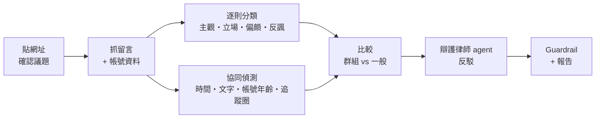

# 留言雷達 Comment Radar：專案摘要

> 2026-11-23 版。細節和出處見 [political-data-feasibility.md](political-data-feasibility.md)。
> ⚠️ DESIGN.md 要自己手寫，不要從這份複製句子。
> 畫面原型：[prototype.html](prototype.html)（用瀏覽器打開）

---

## 1. 主題

**政治留言區的「協同帳號 + 偏頗程度」雷達。**

使用者貼上一支政治影片或一則政治貼文的網址，agent 回答三個問題：

| 問題 | 輸出 |
|---|---|
| 每則留言是**中立**，還是**過度主觀偏頗**？ | 每則留言的標籤 |
| 有沒有一群帳號在**協同行動**？ | 可疑群組 + 證據 + 信心分數 |
| 協同群組和一般留言者的**立場與偏頗程度差多少**？ | 並排比較圖 |

**目標使用者：** 記者、事實查核者。他們需要知道一個政治留言區的「民意」有多少是真的。

**原則：** 只標群組，不點名個人；不幫頻道打分數（YouTube 政策限制）。

### 「中立」和「偏頗」怎麼定義

每則留言標 3 個欄位：

| 欄位 | 值 | 意思 |
|---|---|---|
| `subj` | SUBJ / OBJ | 個人意見，還是陳述事實 |
| `stance` | FAVOR / AGAINST / NONE | 對這串的議題（使用者確認）支持、反對、沒表態 |
| `loaded` | 0 / 1 | 有沒有貼標籤、侮辱、誇大、煽動的字眼 |

- **中立** = OBJ 且 `loaded=0`
- **過度主觀偏頗** = SUBJ 且 `loaded=1`
- 有意見但用字克制（SUBJ、`loaded=0`）= **正常意見**，不算偏頗

---

## 2. 資料來源

### 2.1 主要來源（三個就夠）

| 來源 | 用途 | 費用 | 要不要 key |
|---|---|---|---|
| **YouTube Data API v3** | demo：政治影片留言 | 免費，每天 10,000 單位 | 要 |
| **Bluesky API** | demo：政治貼文回覆 + 追蹤關係 | 免費 | 不用（搜尋翻頁才要登入） |
| **FCC ECFS API** | eval：2017 網路中立性意見徵集，有大量已知的假留言 | 免費，每小時 1,000 次 | 要 |

#### YouTube Data API v3

**去哪拿：**

1. 到 [console.cloud.google.com](https://console.cloud.google.com/) 建專案（可以和 Cloud Run 同一個專案）。
2. **APIs & Services → Library**，搜尋 `YouTube Data API v3` → **Enable**。
3. **APIs & Services → Credentials → Create credentials → API key**。建議把 key 限制成只能呼叫 YouTube Data API v3。
4. 本機放在 `YT_KEY` 環境變數；Cloud Run 上放 Secret Manager。

**會用到的端點（每次 1 單位）：**

```bash
# 美國熱門的新聞與政治影片（category 25，T16 要用 videoCategories.list 確認）
curl "https://www.googleapis.com/youtube/v3/videos?part=snippet,statistics&chart=mostPopular&videoCategoryId=25&regionCode=US&maxResults=50&key=$YT_KEY"

# 某支影片的留言（每頁 100 則）
curl "https://www.googleapis.com/youtube/v3/commentThreads?part=snippet,replies&videoId=$VIDEO_ID&maxResults=100&order=time&key=$YT_KEY"

# 留言者的頻道建立日期（一次 50 個）
curl "https://www.googleapis.com/youtube/v3/channels?part=snippet,statistics&id=$ID1,$ID2&key=$YT_KEY"
```

- 一支 1,000 則留言的影片約 50 單位，一天可以跑約 200 支。
- `search.list` 從 2026/6/1 起一天只能呼叫 100 次，所以 demo 影片要事先挑好。

#### Bluesky

**去哪拿：** 讀取不用 key。

```bash
# 網址 bsky.app/profile/{handle}/post/{rkey} → 先把 handle 換成 DID
curl "https://public.api.bsky.app/xrpc/com.atproto.identity.resolveHandle?handle=$HANDLE"

# 抓整串回覆
curl "https://public.api.bsky.app/xrpc/app.bsky.feed.getPostThread?uri=at://$DID/app.bsky.feed.post/$RKEY&depth=6"

# 回覆者的帳號資料（一次最多 25 個）、追蹤清單
curl "https://public.api.bsky.app/xrpc/app.bsky.actor.getProfiles?actors=$H1&actors=$H2"
curl "https://public.api.bsky.app/xrpc/app.bsky.graph.getFollows?actor=$HANDLE&limit=100"

# 找政治貼文（未登入只能拿第一頁）
curl "https://api.bsky.app/xrpc/app.bsky.feed.searchPosts?q=congress&sort=top&lang=en&limit=25"
```

**需要翻頁搜尋時：**

1. 開一個專案用的 Bluesky 帳號。
2. **Settings → Privacy and security → App passwords** → 新增一組。
3. 用 `POST https://bsky.social/xrpc/com.atproto.server.createSession` 登入拿 `accessJwt`，之後的請求帶 `Authorization: Bearer $JWT`，送到 `https://bsky.social/xrpc/...`。

#### FCC ECFS（17-108 號案）

**去哪拿：**

1. 到 [api.data.gov/signup](https://api.data.gov/signup/) 填 email，key 會寄到信箱。
2. 沒拿到 key 前可以先用 `DEMO_KEY`（每小時只有約 10 次）。

```bash
# 一次 1,000 則，附全文和毫秒時間
curl "https://publicapi.fcc.gov/ecfs/filings?api_key=$FCC_KEY&proceedings.name=17-108&q=%22unprecedented%20regulatory%20power%22&limit=1000&sort=date_received,ASC"
```

- 實測：這句模板一次抓到 1,000 則一字不差的留言，全部在 18 秒內送出。全案同一句話約 82 萬筆。
- Pew 統計這個案子約 94% 的留言是重複送出的 → **現成的協同標準答案**。
- 署名可能是被冒用的真人姓名：**只存雜湊值，不顯示**。

### 2.2 標註資料集（eval 用）

| 任務 | 資料集 | 去哪拿 | 大小 |
|---|---|---|---|
| 主觀性 | CheckThat! 2025 Task 1 | [GitLab](https://gitlab.com/checkthat_lab/clef2025-checkthat-lab/-/tree/main/task1)，`test_en_labeled.tsv` | test 300 句 |
| 立場 | VAST（NYT 讀者留言，有反諷標記） | [GitHub](https://github.com/emilyallaway/zero-shot-stance)，`data/VAST/vast_test.csv` | test 3,006 則 |
| 立場 | TweetEval stance | HF `cardiffnlp/tweet_eval`，子集 `stance_hillary` 等 | 每個子集約 1,000 則 |
| 偏頗用字 | BABE | HF `mediabiasgroup/BABE` | test 1,000 句 |
| **全部（主要 eval）** | **自建 300 則** | YouTube 100 + Bluesky 100 + FCC 100，兩人各自標 | 300 則 |

```python
from datasets import load_dataset
import pandas as pd, csv

babe    = load_dataset("mediabiasgroup/BABE")
hillary = load_dataset("cardiffnlp/tweet_eval", "stance_hillary")
ct   = pd.read_csv("https://gitlab.com/checkthat_lab/clef2025-checkthat-lab/-/raw/main/task1/data/english/test_en_labeled.tsv",
                   sep="\t", quoting=csv.QUOTE_NONE)
vast = pd.read_csv("https://raw.githubusercontent.com/emilyallaway/zero-shot-stance/master/data/VAST/vast_test.csv")
```

### 2.3 備選（主線不用）

- **Regulations.gov**：聯邦法規意見，但全文要一則一則抓。key 一樣在 api.data.gov 申請。
- **Polis vTaiwan**：197 則繁中留言，CC BY 4.0，只當簡報的台灣故事素材。`curl -LO https://raw.githubusercontent.com/compdemocracy/openData/master/vtaiwan.uberx/comments.csv`

---

## 3. 實際運行怎麼做



| 步驟 | 做什麼 | 用什麼 |
|---|---|---|
| 1 | 使用者貼網址。agent 從標題擬一個議題（例如 “the Senate border bill”），使用者確認 | LLM |
| 2 | 抓最新 1,000 則留言和留言者帳號資料 | MCP 工具 `fetch_thread`、`get_accounts` |
| 3 | 逐則分類 | 本機模型（見下表），低信心和疑似反諷的才交給 LLM 重判 |
| 4 | 找協同群組：時間爆發、文字相似、帳號同週建立、互相追蹤 | MCP 工具 `score_coordination` |
| 5 | 比較群組和一般留言者的立場分布、偏頗比例（卡方檢定） | 程式計算 |
| 6 | 每個群組派一個調查員 agent 寫證據；辯護律師 agent 找無辜的解釋，證據不夠就降級 | 平行 agent + Generator/Critic |
| 7 | Guardrail 擋掉點名個人、頻道分數；輸出固定 JSON，前端畫圖 | 結構化輸出 |

**模型（全部在 Cloud Run CPU 跑，4 vCPU / 8 GiB）：**

| 任務 | 模型 |
|---|---|
| 主觀性 | `GroNLP/mdebertav3-subjectivity-english` |
| 偏頗用字 | `mediabiasgroup/roberta-babe-ft` |
| 立場 | `MoritzLaurer/deberta-v3-base-zeroshot-v2.0`（NLI zero-shot） |
| 反諷旗標 | `cardiffnlp/twitter-roberta-base-irony` |
| 重判 | 便宜的 LLM（例如 `gpt-5-nano`），只處理約 20% 的留言 |

**課程概念：**

| 概念 | 類別 | 在哪裡 |
|---|---|---|
| Using your own MCP Server | Coding Agents | `radar-mcp` 提供抓資料、分類、協同評分 |
| Parallel fan-out | Multi-Agent | 每個群組一個調查員 |
| Generator/Critic | Multi-Agent | 調查員 vs 辯護律師 |
| Structured output | Tools | 每則留言和每個群組的 JSON |
| Guardrails | Tools | 不點名個人、不給頻道分數 |
| Offline eval + hill-climbing | Evaluation | 自建 300 則 + FCC 標準答案，固定偽陽性上限調門檻 |

---

## 4. 預計成效和結果

### 使用者會看到什麼

- 整串的摘要：中立 / 正常意見 / 過度偏頗的比例。
- 可疑群組卡片：帳號數、證據、信心分數、辯護律師的意見。
- **核心圖表：協同群組 vs 一般留言者的立場和偏頗比例。** 例如一般留言者意見分歧，群組卻 100% 同一立場、80% 用煽動字眼。
- 每則留言的標籤，偏頗用字會被標出來。

### 量化目標

| 指標 | 目標 | 怎麼量 |
|---|---|---|
| 主觀性準確度 | macro F1 ≥ 0.70 | CheckThat! test |
| 三個欄位準確度 | macro F1 ≥ 0.60 | 自建 300 則 |
| 標註一致度 | kappa：`subj`、`stance` ≥ 0.6；`loaded` ≥ 0.5 | 兩人各自標 |
| 協同抓到率 | ≥ 0.9 | FCC 模板群組 |
| 誤判率 | ≤ 5% 的普通影片被判成「有協同群組」 | 首播、直播等普通政治影片 |
| 反諷的影響 | 報告準確率落差 | VAST 的 431 則反諷留言 |
| 速度 | 1,000 則 ≤ 2 分鐘（評分上限 5 分鐘） | Cloud Run 實測 |
| 成本 | 每個任務 < 0.05 美元 | LLM token 計算 |

### 給評分者的三個任務（草稿）

1. **貼上準備好的政治影片網址** → 看到一個協同群組，立場整齊一面倒；一般留言者意見分歧。
2. **貼上一支直播聽證會的影片** → 留言有暴增，但辯護律師判定是直播造成，結論「沒有明顯協同」。
3. **選 FCC 17-108 範例** → 抓出模板群組，並顯示和 Pew 標準答案的對照。

### 要注意

- YouTube 政策：只顯示單則留言的分析，標示「這是 Comment Radar 的分析」，不做頻道分數。
- 反諷是最大的弱點：疑似反諷的留言標「低信心」，不假裝判得準。
- 立場模型在 CPU 上可能偏慢：超過時間就限制留言數，或把立場交給 LLM。

---

## 5. Prototype

打開 [prototype.html](prototype.html)。裡面是任務 1 的畫面，**所有資料都是假的**，只用來呈現版面。
